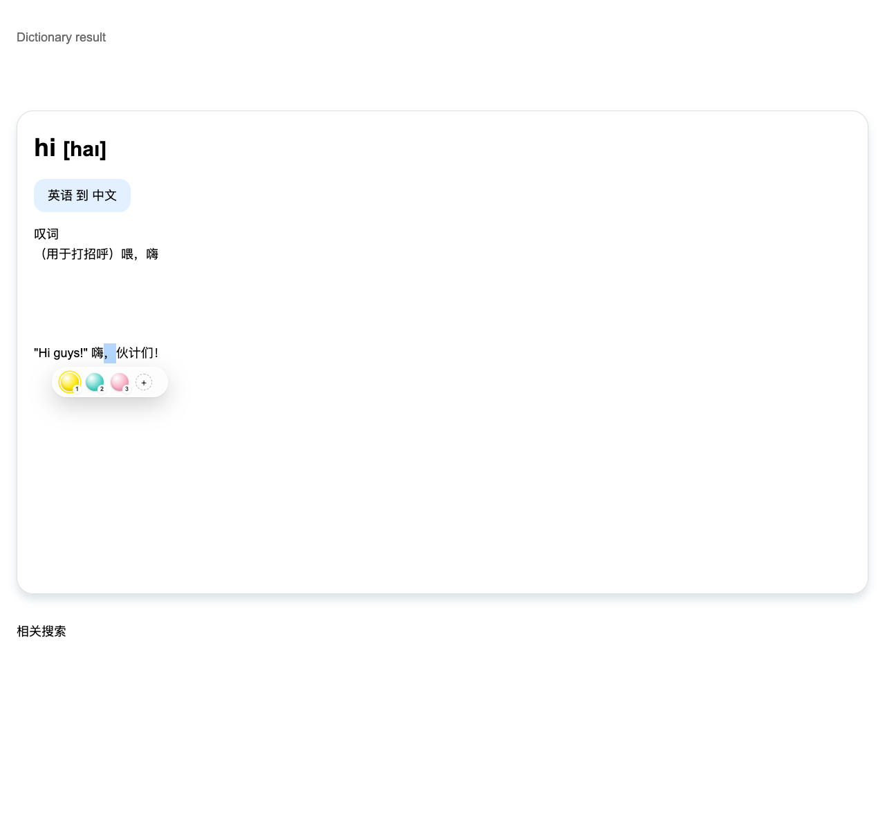

# 0.9.9 工具条距离验证

用户反馈：在必应词典高卡片中选中一个中文逗号，Locus 工具条有时出现在卡片下方，远离文字。验证使用本地合成词典卡片、相邻搜索气泡，以及隔离无头浏览器。没有访问用户工作窗口、真实笔记、凭据或网盘。

## 两种新问题与版本差异

1. 根元素平移或 CSS 缩放会改变 fixed 元素的坐标系。旧实现直接把视口坐标写为 CSS 坐标，产生重复换算；宽高也没有换算到相同单位。
2. Range 的整体矩形可能包含被完整选中元素的空白高度。高内联元素里只有一个逗号，整体选区仍可能高达数百像素。新实现仅测量范围内实际文字，保存仍使用未改动的原始 Range。

安装目录的 manifest 只读检查为 0.9.6，安装记录仍标记 `runtimeReloadPending: true`；这不能证明当前页面运行的版本。归档 0.9.4 在普通词典卡片上复现了类似截图的远移；0.9.6 与 0.9.8 在该普通场景已经保持贴近，但仍有上述坐标与文字测量问题。没有证据将这两种新问题直接归因于真实必应页面。

## 实际绘制位置

距离为工具条与选中文字矩形之间的最短距离，使用实际 `getBoundingClientRect()`，不是 CSS top 值。避让气泡场景可放在文字上方。

| 本地场景 | 修复前 | 0.9.9 |
| --- | ---: | ---: |
| 普通高卡片 + 单个逗号 + 搜索气泡 | 0.9.4：349.02 px；0.9.6 / 0.9.8：10 px | 10 px |
| 根元素向下平移 240 px | 0.9.8：250 px | 10 px |
| 根元素 CSS zoom 1.5 | 0.9.8：405.47 px | 10 px |
| 选中 240 px 高内联元素里的逗号 | 0.9.8：226 px | 10 px |

原始矩形见 [基线数据](toolbar-0.9.9/baseline.json)、[候选修复数据](toolbar-0.9.9/after.json) 和 [最终发行包数据](toolbar-0.9.9/production.json)。最终 Edge ZIP 未修改 manifest，解压后在临时无头 Chromium 中独立加载；四个场景实际间距均为 10 px。以下截图来自该发行包。

## 验证范围

最终类型检查、469 项单元测试和一次完整的 96 项浏览器回归通过。

E100–E102 覆盖高卡片单标点、相邻气泡、根元素平移、0.75 / 1.5 倍 CSS zoom、1.25 倍 transform scale、嵌套滚动、页面滚动、调整视口、元素高度及字体变化、标注保存与重载。断言工具条实际位于视口内、与文字及气泡不重叠，并保持贴近。

定位层增加一个不可交互的固定参考元素，每次定位测量其原点与缩放，不新增计时器。普通文本节点选区不遍历页面。坐标写入容忍 CSSOM 的极小小数舍入，分数缩放下静止位置也不会反复写相同样式。

## 大选区开销

精确文字测量的初版实现逐节点判断相交，5000 个文本节点时出现明显回退，因此未发布该实现。最终实现直接遍历选区首尾之间的文本，避免反复比较节点位置及跨节点移动 Range 端点；仍精确测量全部选中文字，没有删减标注能力或降低检查频率。

同机隔离无头 Chromium、静态布局，直接转译实际源码；预热 10 次，采样 20 次，计数与计时分开。最终 5000 节点中位数 / P95 为 **5.54 / 6.65 ms**，初版为 **69.46 / 73.15 ms**；1000 节点为 0.88 / 1.00 ms。普通单文本节点路径低于约 0.005 ms 的计时分辨率。

原生整体矩形在 5000 节点下为 2.01 / 2.26 ms，但该矩形会把高容器空白算入选区。最终精确测量仍有额外成本，不能据此宣称所有选区都比旧版本更快。测量期间可能同时运行本地回归，结果仅为本机微基准，不代表整页 CPU、耗电或帧率。原始数据及源码散列见 [最终测量](toolbar-0.9.9/measurement.json)、[初版测量](toolbar-0.9.9/measurement-before-linear.json)。

当前修复覆盖正向轴向缩放和平移，没有新增对根元素旋转、倾斜或镜像变换的支持。浏览器原生浮层不属于网页 DOM，仍不能像页面内气泡一样读取其边界。笔记编辑浮层不在本轮工具条坐标修复范围。

本轮未安装到用户正在使用的扩展目录；已加载页面是否更新不能由发行包版本推断。

## 发行包核验

Chrome / Edge ZIP 解压内容一致，CRC 校验通过，manifest 均为 0.9.9；商店包仅移除 manifest key，生产商店校验器通过。

| 文件 | 字节 | SHA-256 |
| --- | ---: | --- |
| locus-0.9.9-chrome.zip | 254262 | `d2a0ee45cf198d4f53557cf1cd879454345c042ee9a3015bbd8e438a1f17d8bb` |
| locus-0.9.9-edge.zip | 254262 | `cbd9cd9bbb98ae18106a6b8a0d967223ddc248c3cd1c03707f92245e740cd39c` |
| locus-0.9.9-edge-store.zip | 253917 | `df018a02c285f70e3f2e11d7d05b7e433864da669733cad193f64512f99003bc` |
