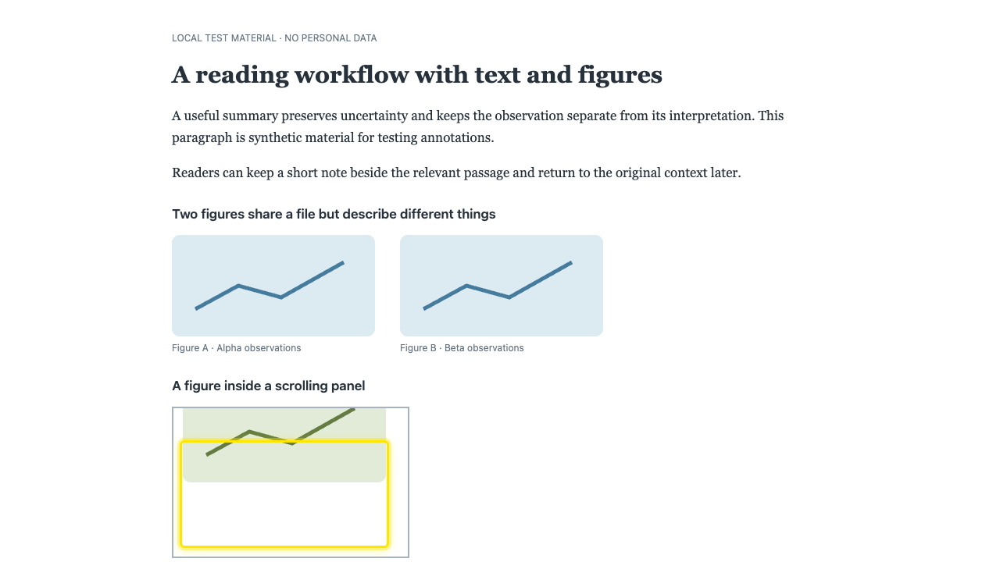
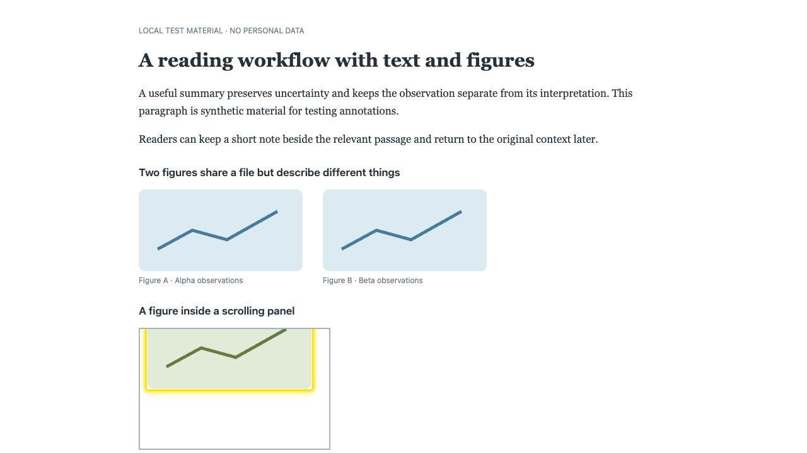

# Locus 0.9.7：从阅读与恢复数据出发的稳健性审查

日期：2026-11-01。对象：本仓库扩展，基线 0.9.6；验收结果见文末。本报告使用合成阅读材料，截图不含用户笔记。

## 专家会先挑战什么

| 用户的问题 | 本轮要求与判断 |
| --- | --- |
| 标的是这张图，还是这个位置？ | 图片重排、重复 URL、资源替换后不能凭旧位置猜图；不能确认时标记为 detached。 |
| 页面滚动或过一会才加载，标记还可信吗？ | 检查内层滚动、裁切、隐藏、移除、延迟加载、尺寸变化以及打开超过 15 秒的页面。 |
| 点了保存，真的存了吗？ | 写入失败保留草稿；处理中不能重复提交；另一窗口已经修改时拒绝旧草稿覆盖。 |
| 中文输入和普通网页操作会被抢走吗？ | 组合输入确认不能当保存；普通图片点击/链接保持原行为；输入框和可编辑正文保留数字与删除键。 |
| 批量操作会不会改错对象？ | 预览时冻结记录版本；选择变化取消旧预览；应用时检测其他窗口的更新。 |
| 一个坏备份条目会不会拖垮整个资料库？ | 校验记录和锚点，阻止空文本搜索死循环；旧格式按实际历史兼容；单个本地坏锚点不得阻断其他标注。 |
| 整理与同步会不会悄悄消耗额度？ | 沿用默认关闭的 LLM、显式生成、按时同步、未变更零上传；只在本地模拟服务上回归。 |

优先顺序是：错误关联和丢稿风险 → 编辑冲突 → 失效数据 → 操作边界 → 视觉上的改进建议。本轮没有增加图片上传或自动调用模型。

## 已修复的实质问题

| 严重度 | 问题与影响 | 改动与验证证据 |
| --- | --- | --- |
| 高 | 同 URL 的图片交换位置后，边框可偏离目标 292 px，暗示标注了另一张图。 | 使用实际加载资源与 alt 辅助识别；重复图片记录匹配数量；不再把失效索引强行落到另一张图。E84、图片锚点单测。 |
| 高 | 内层滚动 80 px 后边框仍留在旧位置；隐藏图片仍可能有标记。 | 滚动合并重绘、按可见区域裁切；尺寸观察只覆盖已标注图片并在清除时释放；根滚动元素不重复裁切。E85、几何单测。 |
| 高 | 中文组合输入确认触发保存；写入失败后编辑器消失、草稿无法重试。 | 组合输入保护、等待实际结果、失败保留草稿、处理中锁定；有改动时点击外部或 Escape 不静默丢稿。E86–E87、编辑器单测。 |
| 高 | 单条和批量笔记可覆盖另一窗口较新的修改；筛选失配会使正在编辑的行卸载、丢失草稿。 | 单条编辑与批量预览冻结版本并原子校验；Library 草稿在稳定的页面会话中保存，行卸载后返回可恢复，后台失败仍可重试。E89–E91、E96–E97、Library 交互单测。 |
| 高 | 空摘录可造成回退定位无限搜索；坏锚点可中断后续标注。 | 定位前校验；导入检查必填文本/时间字段和锚点关联，保留历史默认值；同步拒绝残缺数据；本地逐条隔离错误。E94、anchor/backup/syncFormat 单测。 |
| 中 | 页面打开 15 秒后不再响应 DOM 替换；直接持续全页恢复又会让无关 ticker 增加开销。 | 观察器持续存在，但先检查现有 Range/图片身份，只在相关变化时恢复；状态未变不重复通知；候选脱离文本重试限频。E92、E95。 |
| 中 | 窄窗口笔记卡超出右缘，保存按钮不可用。 | 限制宽高、允许内部滚动和按钮换行，跟随窗口尺寸。E88（280 × 480）。 |
| 中 | 新保存流程与后台原有 Library 权限限制不匹配。 | 网页只获准编辑自身页面单条笔记/删除；跨页批量仍限扩展页面，LLM/主要内容限制保留。真实内容脚本 E83/E86/E87 + 后台授权单测。 |

基线截图：[错位图片边框](images/E85-baseline-failure.png)、[错误图片关联](images/E84-baseline-failure.png)、[窄窗口裁切](images/E88-baseline-failure.png)。五个针对性浏览器场景 E84–E88 在旧构建均出现失败。E87 最初的一次性事务故障可能被存储层重试，其基线截图不能单独证明最终写入失败；旧编辑器提前关闭另有单测和源码证据。最终 E87 持续阻止 annotations 写入，确认可见错误与草稿保留后恢复写入并重试。E92 的测量也改为容忍重绘时暂时不存在的边框。完整原始记录见 [audit-notes.md](audit-notes.md)。

## 修复前后截图

图像来自独立的合成页面，已逐张检查。滚动后边框现在紧贴图像可见边缘，保存失败时草稿和重试按钮仍在。

| 内层滚动：修复前 | 内层滚动：修复后 |
| --- | --- |
|  |  |

[保存失败仍保留草稿](images/after/11-note-save-retry.png) · [280px 窗口操作区完整可用](images/after/12-narrow-note.png)

## 按用户流程验收

| 步骤 | 健康状态 | 证据 |
| --- | --- | --- |
| 1. 选中文本并标色 | 通过（隔离环境） | 工具条邻近选区；E50–E52、E81–E83 |
| 2. 写笔记并保存 | 通过（隔离环境） | 保存、失败重试、组合输入、窄屏；E83、E86–E90 |
| 3. 标注图片并再次打开笔记 | 通过（隔离环境） | 拖动创建；再次拖动打开原笔记；普通点击保持网页行为；E15、E47、E83 |
| 4. 滚动、替换、移除图片后继续阅读 | 通过（隔离环境） | E84–E85、E92–E94 |
| 5. 资料库勾选与批量编辑 | 通过（隔离环境） | 右侧框内选择、空白点击、跨窗口冲突；E53–E55、E77–E80、E89–E91 |
| 6. 配置 LLM、整理主要内容、看状态 | 通过（隔离环境） | 默认关闭、可改 prompt、长度限制、错误和过期结果；E56–E65、E71–E72、E75–E76 |
| 7. 定时/手动同步和恢复备份 | 通过（隔离环境） | 本地模拟 WebDAV；未变更零上传、额度暂停、日程、损坏数据；E66–E70、E73–E74及导入单测 |

## 尚存边界与建议

这些是产品能力或尚未解决的边界，不应被“全部测试通过”掩盖。

- **图片保存的是定位信息和 URL，不是图片文件。** 登录后地址、临时链接或离线页面不保证能预览原图；相同 URL、alt 和数量的不可区分副本仍没有可靠的语义身份。若将来需要离线图册，建议单独设计用户主动保存及容量规则，避免默认增加网盘流量。
- **网页笔记不等于任意网页全文存档。** 当前脚本工作在顶层 HTML；嵌套 iframe、封闭 Shadow DOM、canvas/PDF 内部图像没有获得本轮支持。
- **未保存草稿现在能跨 Library 分组、筛选和折叠保留，但仅存在当前页面内存中。** 刷新或关闭整个 Library 仍会丢弃未保存内容；后续若需跨重启恢复，可设计临时草稿恢复入口，不宜默默自动保存正文。
- **直接单条 Delete/Restore 的失败提示仍可改进。** 批量和笔记编辑路径已有明确反馈；不应声称所有入口的错误恢复体验一致。
- **被过滤坏锚点的笔记正文可保留在数据库/备份中，但正常资料库会跳过缺锚记录。** 建议后续增加“导入有问题的记录”列表与修复/导出入口，优先保证可找回，而非静默猜测定位。
- **跨设备同时编辑正文和删除仍共享行级时间戳。** 已有同步合并规则不等于任意字段并发都能无损收敛；独立冲突版本需要后续格式迁移。
- **已保存的主要内容不会随笔记自动重写。** 保持显式生成；可考虑轻量“笔记已更新”提示，不自动调用 API。
- **低优先级视觉问题：** 只有两张高度不一的卡片时，瀑布列可让右侧空白偏大；LLM 设置较长时保存按钮需要滚动。建议后续单独验证少量卡片排布与固定操作区，避免本轮顺带重做布局。

## 测试隔离与覆盖限度

所有浏览器测试显式 headless、每例临时 profile、串行运行；测试启动参数将外网域名解析禁用，仅放行 localhost/127.0.0.1。测试材料、LLM 与 WebDAV 均为本地合成数据/模拟响应。没有打开或控制用户窗口，没有读取真实笔记/凭据，没有访问真实坚果云，也没有替换正在使用的扩展安装目录。

验证涉及 DOM、实际扩展后台、IndexedDB、键盘事件、可访问名称、焦点及保存的截图。IME 使用组合输入事件模拟，未启动操作系统输入法；未进行读屏器人工测试、全 WCAG 检查、真实网盘配额或用户安装后的运行验证。大文档/持续动画页面未做全面性能基准。这些限制不影响已测场景的修复结论，也不等于对任意网站保证兼容。

最终验证：

- 类型检查通过；28 个单测文件共 **432 项通过**。最终重复检查暴露一项既有颜色初始化测试依赖同毫秒内的 UUID 排序；测试数据改用明确创建时间后重新通过，产品排序规则未变。
- **91 项浏览器用例均已验证**：完整运行中 90 项通过；E80 的旧测试在 liveQuery 替换元素时取得空几何数据，补充新页面就绪等待和当前可见文字测量重试后，连续 3 次通过。未为通过该测试改变产品行为。
- 审计成功截图 12 张已逐张检查；原始失败及测试探针限制保留在 audit-notes.md。
- Chrome/Edge 发布 ZIP 和 Edge 商店候选包的核验结果见同目录 RELEASE-CHECKS.md。安装目录未更新，未执行运行中扩展的重载。
